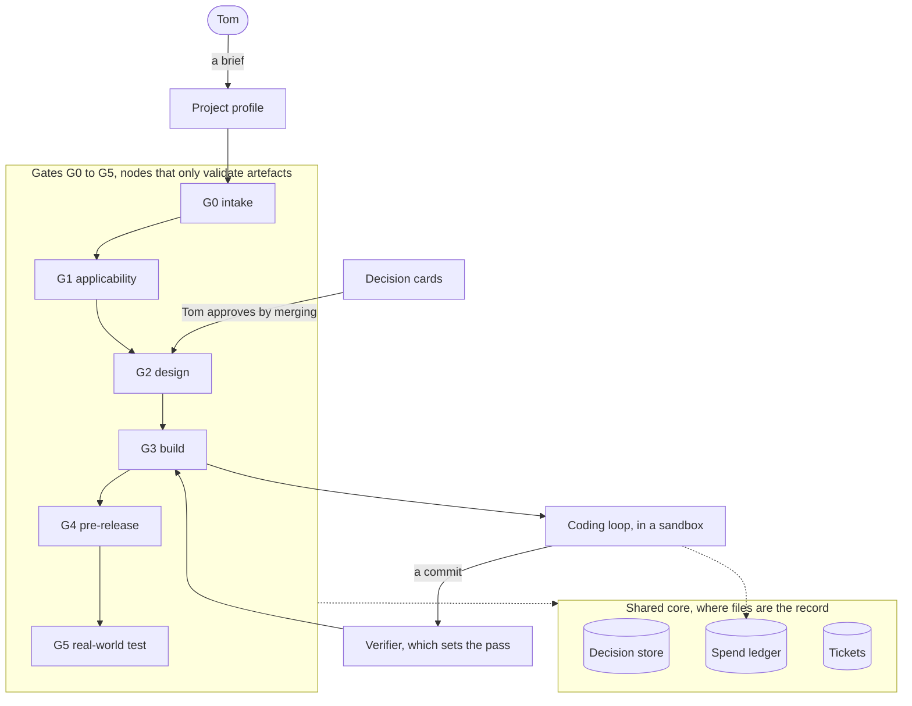
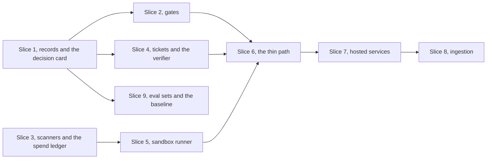

# Sketch: phase 0, the shared core

**Status: proposed, revised for D-008 (D-009). Nothing here is built. For Tom to approve,
change or replace.**

This is the SOP's design sketch (T5) for the charter's phase 0. The first version (D-005) was
reviewed twice (D-006, D-007). Tom adopted five changes (D-008), and this version makes them:
the scanner baseline and the sandbox's refusals are tested in phase 0; a verifier, not the
loop, sets a ticket's pass (ADR-0027); approvals name the exact version they approve
(ADR-0028); the first useful result comes before the hosted services; and the comparison with
a single-session baseline is planned from the start (ADR-0029).

## Purpose, and who calls it

The shared core is the machinery every agent uses, built once (ADR-0003). In phase 0 it has
one job: carry **one thin path from brief to code**, with the harness controls in place before
any agent has a tool. Its callers are the seven experts, the coding swarm, the gates and Tom.

## Shape

One package, `src/kiln/`, one module per component, each a small typed interface over its
internals.

## Contracts others will depend on

Settled in slice 1, before their first consumer, because changing one later means changing
every agent.

| Contract | Proposal |
| --- | --- |
| **Record ids** | Every id names its kind: `DEC-0001` (decision record), `CARD-…` (decision card), `OBL-…` (obligation), `FND-…` (finding), `TKT-…` (ticket). Evidence is addressed by content: `sha256:<hex>`. |
| **Source ids** | Every id an agent sees names its source: `<source>:<local-id>`. Stores keep local ids; the boundary qualifies them (SOP D-057, from the first build). |
| **Decision card** | The question, the options and their consequences, a recommendation, any dissent, whether it can be undone, what happens without an answer, and the files and commits it rests on (ADR-0030). Its id and content hash identify it exactly. |
| **Approval** | A card is approved when Tom merges, into `main`, the commit that holds it. The approval names the card's hash and the hashes of what it rests on, so an edit after approval needs a new one (ADR-0028). No agent merges. |
| **Ticket and pass** | A ticket holds a description, verification steps and a `passes` flag. Only the verifier writes the flag, and it refuses a commit that touches `contracts/`, `fitness/` or the ticket's own verification steps (ADR-0027). |
| **Actor** | Every record names who made it, when, and its id. Prose cannot confer authority (charter rule 5). |
| **Basis** | One enum of seven values on every claim: observed, authoritative, rule, supported, inferred, assumed, unknown. |
| **Bands, tripwires, gates** | One enum each: Green, Amber, Red, Tom; the four tripwires; G0 to G5. |
| **`unknown`** | A valid value in a profile, distinct from missing. |
| **Spend** | Dollars, metered per call, against a named budget in config. A warning at 80% of a budget; a refusal before a call that could pass it. Generalised from `kiln review`'s guard. |
| **Trace names** | `<agent>.<node>`, with the build's identity on every trace (SOP §20.0). |

## What it must survive later

- **Seven agents with their own sections** of one profile, and their own extensions of one
  decision format.
- **Many solutions,** each with its own repo and its own `council/` folder.
- **A second model provider** reviewing a plan it did not write (ADR-0026). `kiln review`
  already does this for documents.
- **The real-data boundary:** nothing in the core may assume it can see real data
  (ADR-0024).
- **Unattended loops.** Before one runs, approvals must come through a path no agent can use
  (ADR-0028's stated limit). Until then, every loop run is watched (HITL).

## Build order

Each slice is one session, runs end to end, and is checked by something that can be run.
Schemas, gates and the verifier are built with Tom watching, as the charter asks.

| Slice | Builds | Needs | Spends | Checked by |
| --- | --- | --- | --- | --- |
| **1. Records and the decision card** | The enums. `ProjectProfile`. `Decision` and a file-backed decision store that renders `DEC-NNNN-<slug>.md`. `DecisionCard`, and `kiln approvals`, which reads `main`'s history to list each approved card with its hash, and flags a card edited after its approval. Three synthetic sample briefs: a public form service, an internal RAG assistant and a data dashboard. | Nothing | $0 | The briefs validate as profiles. Fixture tests for every rejection. A fixture repo where a card changes after its merge shows the approval lapse. |
| **2. Gates** | G0 to G5 as a LangGraph state machine whose nodes only validate artefacts. Only the validation node writes a pass. G2 needs an approved card for the plan, by hash. | Slice 1 | $0 | A sample brief walks G0 to G5 on fixture artefacts. A missing artefact fails its gate. A pass written from outside the validation node is refused. A plan edited after approval fails G2. |
| **3. Scanners and the spend ledger** | Semgrep CE, OSV-Scanner and Trivy in CI, pinned, feeding one finding format. The spend ledger, shared by every paid command. | Nothing | $0 | Each scanner fails CI on a seeded finding. The ledger refuses a call that could pass a cap, and warns at 80%. |
| **4. Tickets and the verifier** | The ticket schema, and the verifier: it runs a ticket's verification steps and every check on a clean checkout of the loop's commit, and writes the pass. | Slice 1 | $0 | A commit that passes its steps gets the pass. One that edits a fitness function, a contract or its own verification steps is refused, whatever its tests say. |
| **5. Sandbox runner** | A Modal runner: a spend cap per run, one scoped, short-lived credential, an egress allowlist (D-005 A2), and nothing else from the environment. | Modal secrets; a budget of cents | Cents | Inside the sandbox, a file, a host and a credential the run was not given are each refused. A run that would pass its cap stops before it does. |
| **6. The thin path** | One sample brief taken end to end: a profile; a plan and one ticket written by a Claude Code session and approved by Tom's merge; a loop implements the ticket in the sandbox; the verifier sets the pass. This is the first useful result, and the first data point of the single-session baseline (ADR-0029). | Slices 1 to 5; an Anthropic key for the loop; a budget | About a dollar | The ticket passes by the verifier's run, not the loop's. Its record names the approved plan's hash. |
| **7. Hosted services** | Pinned clients for Neon (schemas and roles per the charter), R2 (evidence by hash) and Langfuse (a tracer that refuses to be switched off silently). `kiln doctor` gains a live check for each. | Neon and R2 secrets; a Langfuse project for Kiln (D-005 F1); Tom's ruling on F2 | $0 on free tiers | `kiln doctor` reports phase 0 ready. An artefact round-trips by hash. A trace is read back through the API. |
| **8. Ingestion, once** | Fetch, hash, store in R2, normalise, index in Postgres full-text and pgvector, register the source: one path, on one small source, each stage deterministic with a manifest. | Slice 7; an embedding model | Cents, if the embedder is paid | A re-run is byte-identical. The source's inventory is counted before its profile is trusted (SOP §15.1). |
| **9. Eval sets and the baseline protocol** | 20 golden research questions, starting with the charter's own dated policy claims (D-005 R6). The ADR-0029 comparison: the paths, the measures and the rule that decides, committed before either path runs. | Slice 1 | $0 to draft | Claude drafts; Tom approves each set and the rule before any run. |

Slices 1, 3, 4 and 9 need no secret and no money, and can start as soon as this is approved.

The real-data tripwire's check waits for Tom's ruling on D-005 R4 (provenance or screening).
Until then no dataset enters a build, so nothing can trip it.

The other shared-core components in the charter's table (the change monitor, the retrieval
service, the Obligation-Control-Evidence matrix, the renderers, the full capability broker,
the assurance case) arrive with the agent that first needs them, from phase 1 on. Slice 5's
single scoped credential is the broker's minimum, and is enough while one loop runs at a time.

## For Tom

1. **Approve this build order?** *Recommended: yes.* It starts slice 1 only; no code exists
   yet, so it can be undone.
